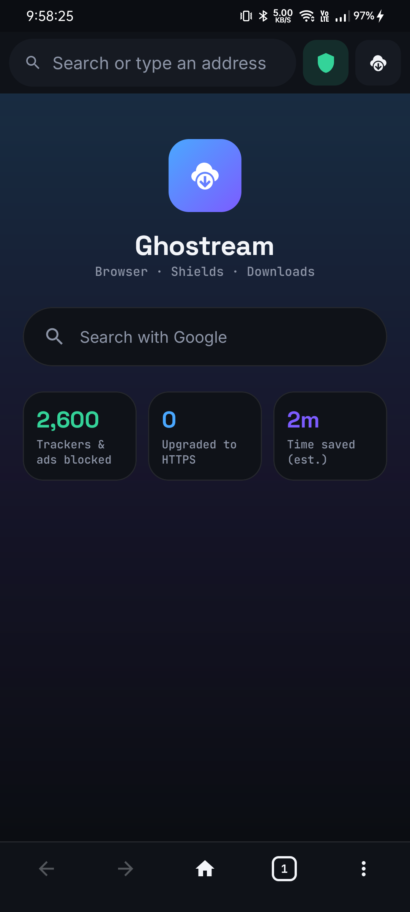
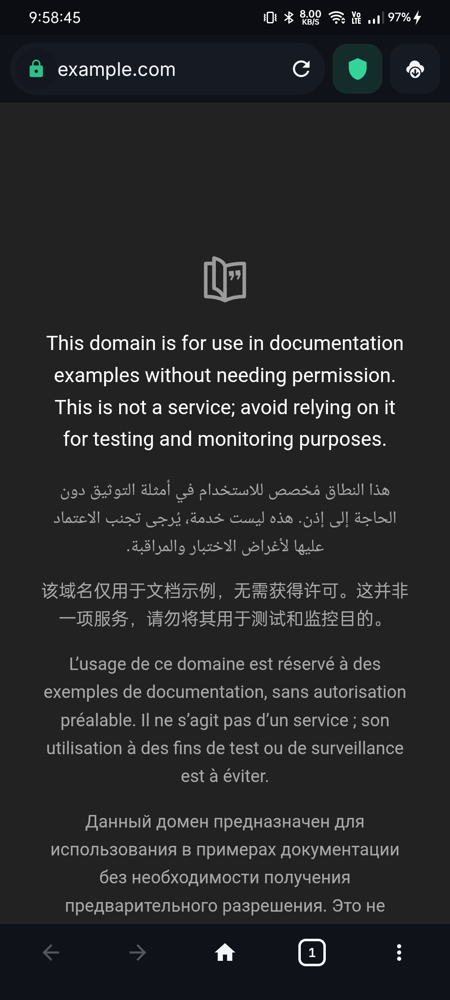
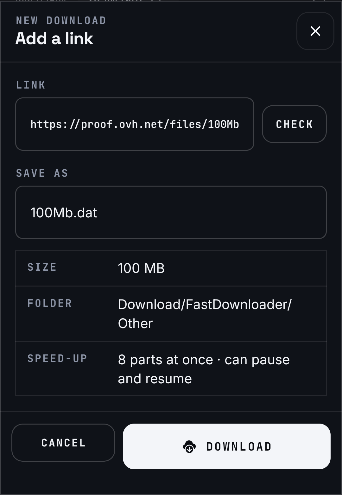
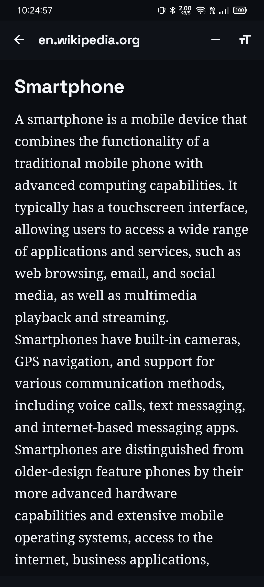
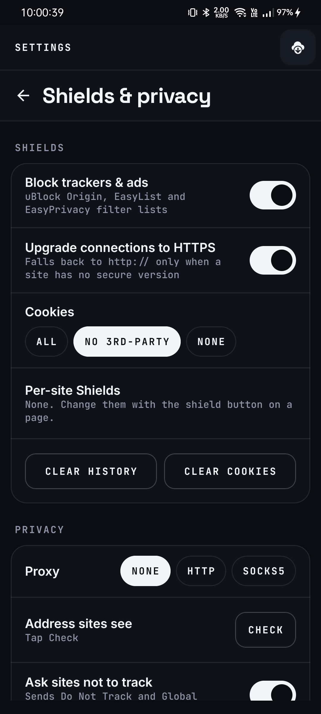
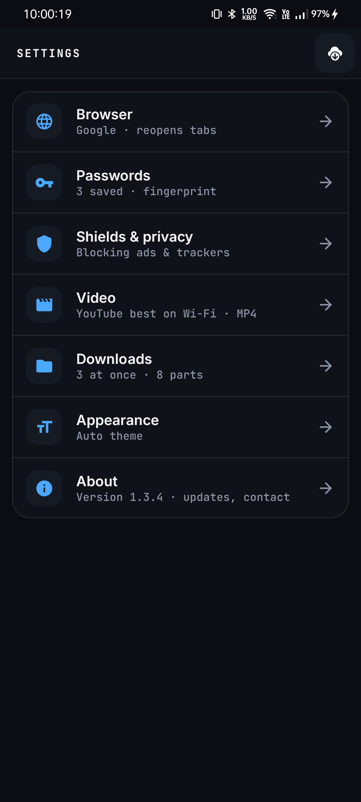

# Ghostream

**Browse. Block. Download.**

Ghostream is a free, open-source Android browser. It blocks ads and trackers, saves videos and files in fast multi-part downloads, and has a reader mode for clean reading.

**Website:** https://janardanpal007.github.io/Ghostream/

## Screenshots

  
  
  
  

  
  

## Features

- **Built-in browser:** tabs, private tabs, bookmarks, history and a fast address bar.
- **Ad and tracker blocking:** uses open filter lists (uBlock Origin, EasyList, EasyPrivacy) and a per-site shield.
- **Fast downloads:** each file is split into up to 8 parts, with pause and resume.
- **Video and torrents:** save videos from supported sites and open magnet links or `.torrent` files.
- **Reader mode:** shows only the article, in clean text, with text size controls.
- **Privacy controls:** HTTPS upgrade, cookie settings, tracking-tag removal and optional proxy.
- **Sorted folders:** downloads go into folders by type.

## Download

Get the latest APK from the [Releases page](https://github.com/Janardanpal007/Ghostream/releases/latest).

- `Ghostream-<version>-android-arm64.apk`: for most 64-bit phones
- `Ghostream-<version>-android-universal.apk`: works on any phone

**Requirements:** Android 8.0 (API 26) to Android 17.

**Install:** open the APK on your phone. If Android asks, allow installs from your browser, then tap **Install**.

## Source code

The Android app's source code is in the [`android/`](android/) folder.

## License

Ghostream for Android is free software under the **GNU General Public License v3** ([`android/LICENSE`](android/LICENSE)). It includes [youtubedl-android](https://github.com/yausername/youtubedl-android), which is GPL-3.0. Third-party components and their licenses are listed in [`android/NOTICE.md`](android/NOTICE.md).

## Author

Built by Janardan Pal. [GitHub](https://github.com/Janardanpal007)
